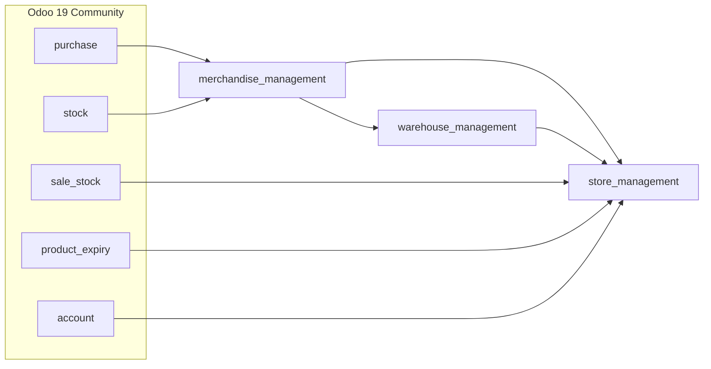
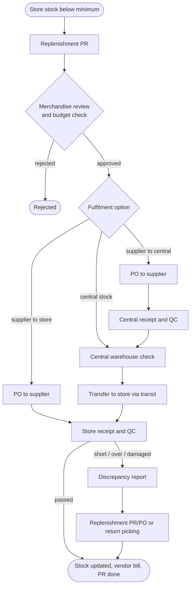
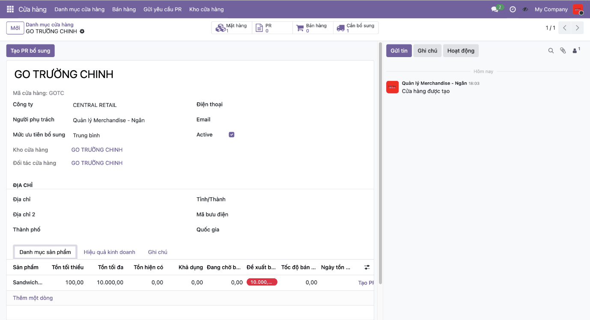
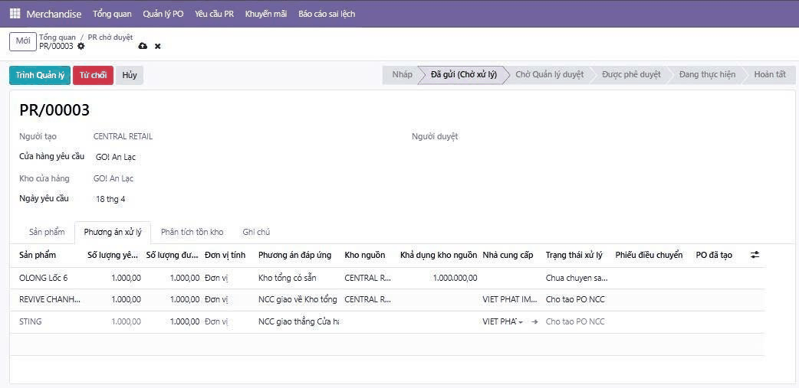
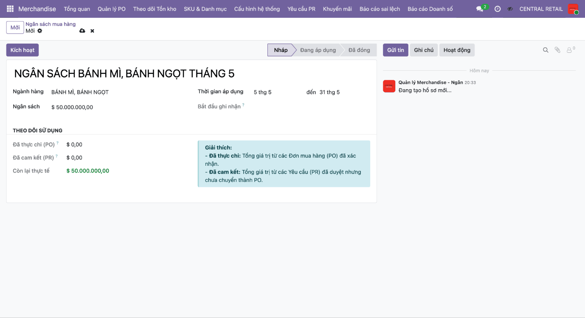
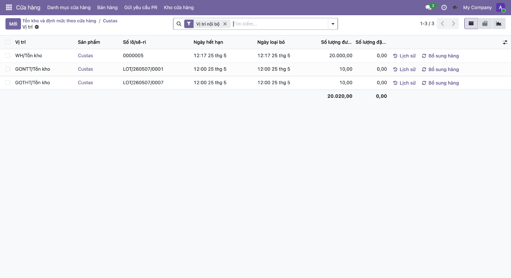
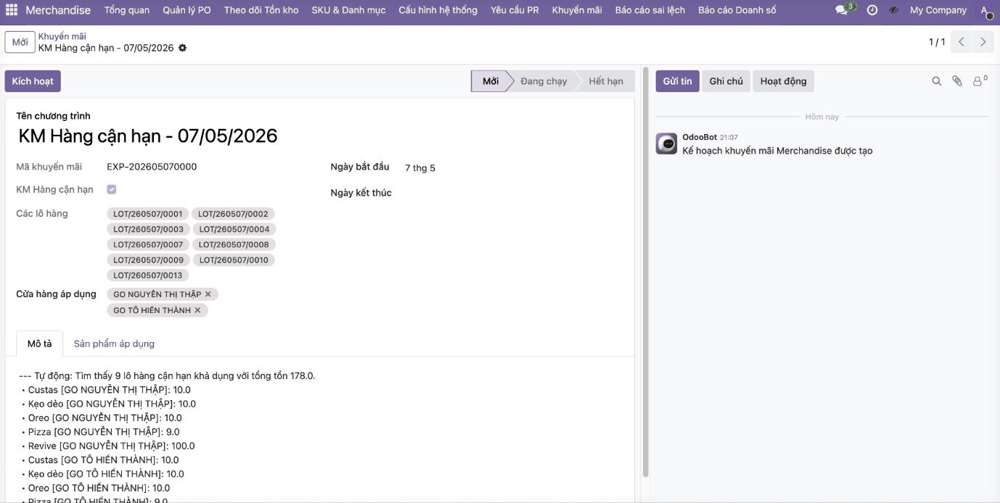
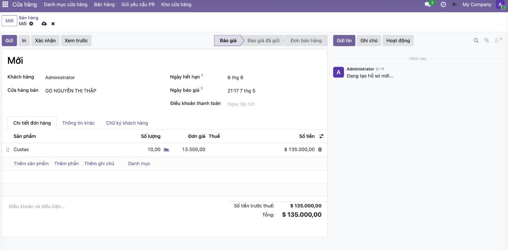

<div align="center">

# MIS Purchasing

### Retail procurement and store replenishment on Odoo 19

[](https://www.odoo.com/)
[](https://www.python.org/)
[](https://www.postgresql.org/)
[](https://huggingface.co/spaces/IceMisha/OdooProject)
[](LICENSE)

**English** · [Tiếng Việt](README.vi.md)

</div>

## Team

**Group 1** — Institute of Information Technology and Electrical & Electronic Engineering,
Ho Chi Minh City University of Transport (UTH), 2026.

| Member | Member |
| --- | --- |
| Huỳnh Thái Bảo Ngân | Nguyễn Thị Mỹ Trinh |
| Phạm Như Trâm | Hoàng Quốc Khánh |
| Đỗ Hoàng Phúc | Trần Nguyên Thịnh |

**Supervisor:** MSc. Lê Hữu Thanh Tùng

> Project for the *Management Information Systems — Practical Project* course. The business analysis is
> based on a survey of procurement processes at Central Retail Vietnam; this repository is an academic
> prototype and is not affiliated with or endorsed by Central Retail.

## Contents

- [Overview](#overview)
- [AS-IS vs. TO-BE](#as-is-vs-to-be)
- [Modules](#modules)
- [Features by role](#features-by-role)
- [Business flow](#business-flow)
- [Screenshots](#screenshots)
- [Fit-gap analysis](#fit-gap-analysis)
- [Running locally](#running-locally)
- [Deployment on Hugging Face Spaces](#deployment-on-hugging-face-spaces)
- [Project structure](#project-structure)
- [Evaluation and roadmap](#evaluation-and-roadmap)
- [License](#license)

## Overview

Large multi-store retailers replenish goods from two sources: a central warehouse and external
suppliers. In the surveyed process, data between stores, Merchandise, the warehouse and suppliers was
not synchronised in real time, many steps relied on manual work and e-mail, and there was no early
warning for stock-outs, overstock, near-expiry goods or delivery discrepancies.

This project models the improved **TO-BE** process in BPMN, runs a **fit-gap analysis** against
standard Odoo, and closes the gaps with three custom add-ons for Odoo 19 Community. The
**Purchase Requisition (PR)** becomes the central document that links store demand, Merchandise
decisions, purchase orders, internal transfers, quality control and replenishment.

## AS-IS vs. TO-BE

| Area | AS-IS | TO-BE (implemented) |
| --- | --- | --- |
| Creating a PR | Manual, out of sync, depends on staff | Suggested from store min/max levels, routed per supply source |
| Detecting shortages | Periodic manual stock checks | Available and pending quantities tracked per store |
| Near-expiry goods | Handled manually, often too late | Lots close to expiry detected automatically (days configurable per product) |
| Promotions | Created manually, hard to look up | Generated daily by a scheduler, searchable by code, product and store |
| Receiving discrepancies | E-mail back and forth | Shortage / overage / damaged reports linked to replenishment PRs, POs or returns |
| Spend control | Checked after the fact | Approval refused when a category budget would be exceeded |

## Modules



| Module | Purpose |
| --- | --- |
| [`merchandise_management`](custom_addons/merchandise_management) | Multi-step PR approval, category budgets, SKU lifecycle and ABC class, stop-ordering, promotions (incl. near-expiry), discrepancy reports, supplier scoring, dashboard |
| [`warehouse_management`](custom_addons/warehouse_management) | QC on incoming receipts (pass / reject), damaged quantities, automatic return to supplier or internal return |
| [`store_management`](custom_addons/store_management) | Store master data and min/max levels, replenishment suggestions, central warehouse → store transfers via transit, receipt checks, store sales with promotion prices, simple vendor bills |

Installing **Store Management** installs the other two modules automatically.

## Features by role

**Store**

- Store catalogue with responsible user, replenishment priority and a dedicated warehouse (created automatically).
- Per-product min / max levels with on-hand, available, pending and suggested replenishment quantities.
- 30-day sales velocity, days of stock and stock status (out of stock, shortage, normal, high, overstock).
- One-click replenishment PR; duplicate PRs for products already in progress are blocked.
- Receiving with an actual-count step, then shortage, overage or damaged reporting.
- Sales orders limited to the store assortment, with promotion prices and quotas applied automatically.
- Revenue, gross profit and margin per store.

**Merchandise**

- PR workflow: Draft → Submitted → To approve → Approved → In progress → Done (or Rejected / Cancelled).
- Fulfilment option per PR line: central stock, supplier → central warehouse, or supplier → store.
- Purchase budgets per product category with spent (PO), committed (PR) and remaining amounts.
- SKU lifecycle (new, active, slow, phase-out, discontinued), ABC classification and stop-ordering flag.
- One-click replenishment PR / PO or return picking from a discrepancy report.
- Store-level promotions with quantity limits; a daily scheduler creates near-expiry promotions and refreshes prices.
- Supplier reliability score, rating and average lead time; dashboard with KPIs, PR pipeline and recent activity.

**Warehouse**

- Receiving QC: start check → pass (validates the receipt) or reject (note required).
- Damaged quantity and notes per line; expected vs. received discrepancy tracking.
- Rejected receipts automatically create a return to the supplier or an internal return.
- Central stock check for store requests, delivery through a transit location with lot numbers carried over.
- Vendor bill created automatically once goods are received.

## Business flow



The full BPMN model (Bizagi) is available in [`docs/bpmn-to-be-process.pdf`](docs/bpmn-to-be-process.pdf).

## Screenshots

| Store min/max and replenishment | PR fulfilment options |
| :---: | :---: |
|  |  |
| **Category purchase budget** | **Stock by lot and expiry date** |
|  |  |
| **Auto-generated near-expiry promotion** | **Store sale with promotion price** |
|  |  |

## Fit-gap analysis

| Business area | Standard Odoo | Fit | Solution in this repository |
| --- | --- | --- | --- |
| Store demand and internal PR | No store → Merchandise PR flow | Partial | `store_management` + `merchandise_management` PR |
| PR approval | Configurable, but not this workflow | Partial | Custom multi-step states and role checks |
| Purchase orders | Fully supported | Full | Standard Purchase, PO linked to source PR |
| Inventory and transfers | Fully supported | Full / config | Warehouses, transit routes, pickings |
| Choosing the supply source | Not exposed per PR line | Gap / partial | Fulfilment option tab on PR lines |
| Receiving and quality check | Receipt only, no QC logic | Partial | `warehouse_management` QC |
| Discrepancy handling | Stock adjustment / returns only | Gap | Discrepancy reports linked to PR / PO / returns |
| Promotions | Exists, not store- or lot-centric | Partial | Store-level promotions and near-expiry scheduler |
| Status tracking | Per document | Partial | Central flow status and Merchandise dashboard |

## Running locally

The modules run on a standard Odoo 19 source installation; Docker is not required for development.

**Requirements**

- Python 3.10 or later
- PostgreSQL 13 or later
- Odoo 19.0 source code — see the [official source install guide](https://www.odoo.com/documentation/19.0/administration/on_premise/source.html)

**1. Get Odoo and this repository**

```bash
git clone --depth 1 --branch 19.0 https://github.com/odoo/odoo.git odoo-19.0
git clone https://github.com/HoangPhucTony/Mis_Purchasing_OdooProject.git
```

**2. Install Odoo's Python dependencies** (a virtual environment is recommended)

```bash
cd odoo-19.0
python -m venv .venv
.venv\Scripts\activate
pip install -r requirements.txt
```

On Linux/macOS activate with `source .venv/bin/activate`.

**3. Create a PostgreSQL user for Odoo**

```sql
CREATE ROLE odoo WITH LOGIN CREATEDB PASSWORD 'odoo';
```

**4. Configure Odoo** — copy [`odoo.conf.example`](odoo.conf.example) to `odoo.conf` and set
`addons_path` to Odoo's `addons` folder plus this repository's `custom_addons` folder, together with
your database credentials.

**5. Run and install the modules**

```bash
python odoo-bin -c ../Mis_Purchasing_OdooProject/odoo.conf -d mis_purchasing -i store_management
```

Open <http://localhost:8069> and sign in with `admin` / `admin`. Then, under
**Settings → Users**, give each user an access level under *Bộ phận Merchandise* (Merchandise),
*Cửa hàng* (Store) or *Kho* (Warehouse QC).

After changing the code, upgrade the modules with:

```bash
python odoo-bin -c ../Mis_Purchasing_OdooProject/odoo.conf -d mis_purchasing -u merchandise_management,warehouse_management,store_management
```

## Deployment on Hugging Face Spaces

The live demo runs as a Docker Space built from the [`Dockerfile`](Dockerfile) (official `odoo:19.0`
image, listening on port 7860).

1. Every push to `main` triggers the [GitHub Actions workflow](.github/workflows/sync_to_hf.yml).
2. The workflow adds the Space metadata from [`.github/hf-space-metadata.md`](.github/hf-space-metadata.md)
   to `README.md` and pushes the repository to the Space.
3. The Space rebuilds the image and starts Odoo against an external PostgreSQL database.

Configure these variables under *Space → Settings → Variables and secrets*
(template: [`.env.example`](.env.example)):

| Variable | Description |
| --- | --- |
| `DB_HOST`, `DB_PORT`, `DB_USER`, `DB_PASSWORD` | External PostgreSQL connection |
| `ODOO_MASTER_PASSWORD` | Database manager password — always set a strong value |
| `DB_FILTER` | Regex restricting visible databases |
| `MAX_CRON_THREADS` | Scheduler threads (default `1`, `0` disables crons) |

The GitHub repository needs the secret `HF_DEPLOY_ODOO`, a Hugging Face access token with write permission.

To test the Space image on your machine, [`docker-compose.yml`](docker-compose.yml) starts the same
image together with PostgreSQL: `docker compose up -d --build`, then open <http://localhost:7860>.

## Project structure

```text
.
├── custom_addons/
│   ├── merchandise_management/   PR, budgets, promotions, discrepancies, dashboard
│   ├── store_management/         stores, min/max, central → store flow, store sales
│   └── warehouse_management/     receiving QC, returns
├── docs/
│   ├── images/                   screenshots used in this README
│   └── bpmn-to-be-process.pdf    BPMN model of the TO-BE process
├── .github/
│   ├── workflows/sync_to_hf.yml  deployment to Hugging Face Spaces
│   └── hf-space-metadata.md      Space configuration header
├── Dockerfile                    image for Hugging Face Spaces
├── docker-compose.yml            local test of the Space image
├── odoo.conf.example             configuration for running from source
└── .env.example                  variables for the Space / Docker
```

## Evaluation and roadmap

The prototype covers the core requirements: the PR is the central document with a clear status
workflow, Merchandise coordinates decisions, and processing branches by supply source (central
warehouse or supplier). Receiving QC, discrepancy handling, replenishment PRs, returns and promotions
are implemented at prototype level.

Next steps:

- [ ] Test with larger, production-like data (many stores, SKUs and concurrent exceptions); pilot on a small scope.
- [ ] Sync POS sales data to drive replenishment from real consumption.
- [ ] Link procurement, transfers and promotions to accounting (costs, payables, budget).
- [ ] Supplier KPIs: on-time delivery, fill rate, defect and discrepancy rates.
- [ ] Role-specific dashboards for stores, Merchandise, the central warehouse and management.
- [ ] Finer-grained access rights and an audit trail across departments.

## License

Released under the [GNU LGPL-3.0](LICENSE), consistent with Odoo Community.
