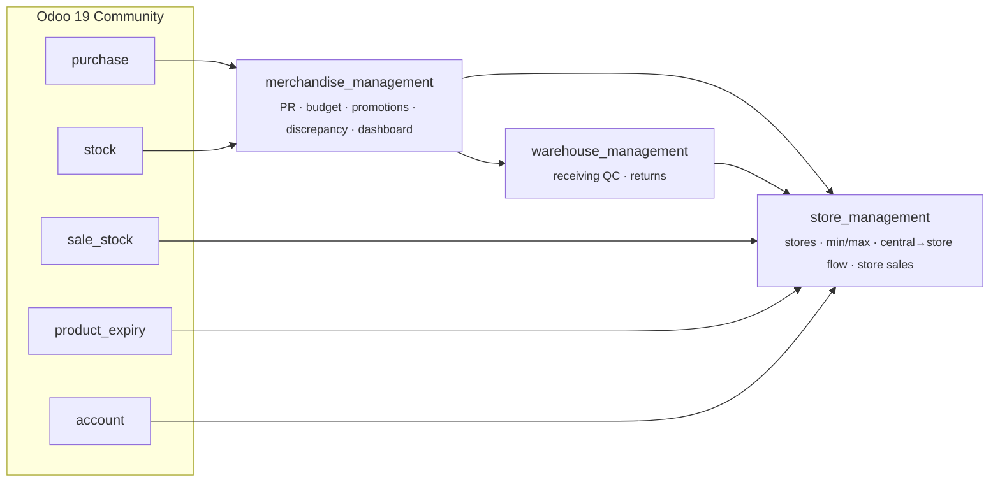
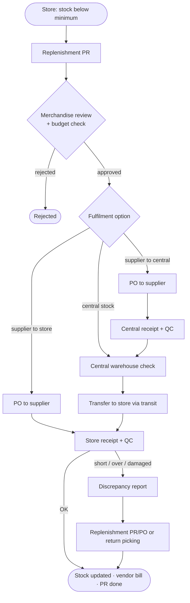

<div align="center">

# 🛒 MIS Purchasing — Retail Procurement on Odoo 19

**Store replenishment · Purchase requisitions · Budget control · Receiving QC · Discrepancy handling · Near-expiry promotions**

[](https://www.odoo.com/)
[](https://www.python.org/)
[](https://www.postgresql.org/)
[](docker-compose.yml)
[](https://huggingface.co/spaces/IceMisha/OdooProject)
[](LICENSE)

**English** · [Tiếng Việt](README.vi.md)

</div>

> Academic project for the *Management Information Systems — Practical Project* course at
> Ho Chi Minh City University of Transport (UTH). The business analysis is based on a survey of
> procurement processes at **Central Retail Vietnam**; this repository is a learning prototype and is
> not affiliated with or endorsed by Central Retail.

---

## 📑 Table of contents

- [Overview](#-overview)
- [From AS-IS to TO-BE](#-from-as-is-to-to-be)
- [Architecture](#-architecture)
- [Features by role](#-features-by-role)
- [Business flow](#-business-flow)
- [Screenshots](#-screenshots)
- [Fit-gap analysis](#-fit-gap-analysis)
- [Getting started](#-getting-started)
- [Deployment](#-deployment)
- [Project structure](#-project-structure)
- [Evaluation & roadmap](#-evaluation--roadmap)
- [Team](#-team)
- [License](#-license)

## 🔎 Overview

Large multi-store retailers replenish goods from **two sources** — a central warehouse and external
suppliers. In the surveyed process, data between stores, Merchandise, the warehouse and suppliers was
not synchronised in real time, many steps relied on manual work and e-mail, and there was no early
warning for stock-outs, overstock, near-expiry goods or delivery discrepancies.

This project models the improved **TO-BE** process in BPMN, runs a **fit-gap analysis** against
standard Odoo, and closes the gaps with three custom add-ons built on Odoo 19 Community:
the **Purchase Requisition (PR)** becomes the central document that links store demand, Merchandise
decisions, purchase orders, internal transfers, quality control and replenishment.

## 🔁 From AS-IS to TO-BE

| Area | AS-IS | TO-BE (implemented) |
| --- | --- | --- |
| Creating a PR | Manual, out of sync, depends on staff | Suggested from store min/max stock levels, routed per supply source |
| Detecting shortages | Periodic manual stock checks | System tracks available + pending quantities per store |
| Near-expiry goods | Handled manually, often too late | Lots close to expiry detected automatically (configurable days per product) |
| Promotions | Created manually, hard to look up | Generated daily by a scheduler, searchable by code, product and store |
| Receiving discrepancies | E-mail back and forth | Shortage / overage / damaged reports linked to replenishment PRs, POs or return pickings |
| Spend control | Checked after the fact | Approval blocked when a category budget would be exceeded |

## 🏗 Architecture



| Module | Purpose |
| --- | --- |
| [`merchandise_management`](custom_addons/merchandise_management) | Multi-step PR approval, category budgets, SKU lifecycle & ABC class, stop-ordering, promotions (incl. near-expiry), discrepancy reports, supplier scoring, OWL dashboard |
| [`warehouse_management`](custom_addons/warehouse_management) | QC on incoming receipts (pass / reject), damaged quantities, automatic return to supplier or internal return |
| [`store_management`](custom_addons/store_management) | Store master data & min/max levels, replenishment suggestions, central-warehouse → store transfers via transit, receipt checks (short / over / damaged), store sales with promotion prices, simple vendor bills |

Installing **Store Management** pulls in the other two modules automatically.

## 👥 Features by role

<details open>
<summary><b>🏪 Store</b></summary>

- Store catalogue with responsible user, replenishment priority and its own warehouse (created automatically).
- Per-product **min / max** levels with on-hand, available, pending and **suggested replenishment** quantities.
- Sales velocity (30 days) and **days of stock**; stock status: out of stock, shortage, normal, high, overstock.
- One-click replenishment PR; duplicate PRs for the same products are blocked.
- Receive goods with an actual-count step, then report shortage, overage or damaged items.
- Store sales orders limited to the store's assortment, with promotion prices and promo quotas applied automatically.
- Business KPIs: revenue, gross profit and margin per store.

</details>

<details open>
<summary><b>📋 Merchandise</b></summary>

- PR workflow: *Draft → Submitted → To approve → Approved → In progress → Done* (or *Rejected / Cancelled*).
- **Fulfilment option per line**: central stock, supplier → central warehouse, or supplier → store; source availability shown inline.
- **Purchase budgets** per product category with spent (PO), committed (PR) and remaining amounts; over-budget approval is refused.
- SKU lifecycle (new, active, slow, phase-out, discontinued), ABC classification and *stop ordering* flag.
- Discrepancy reports → replenishment PR / PO or return picking in one click.
- Promotions per store with quantity limits; **daily scheduler** creates near-expiry promotions and refreshes promotion prices.
- Supplier reliability score, rating and average lead time; dashboard with KPIs, pipeline and recent activity.

</details>

<details open>
<summary><b>🏭 Warehouse</b></summary>

- Receiving **QC**: start check → pass (validates the receipt) or reject (requires a note).
- Damaged quantity and notes per line; expected vs. received discrepancy tracking.
- Rejected receipts automatically generate a return to the supplier or an internal return.
- Central stock check for store requests, delivery via transit location with lot numbers carried over.
- Vendor bill created automatically once goods are received.

</details>

## 🔄 Business flow



The full BPMN model (Bizagi) is available in [`docs/bpmn-to-be-process.pdf`](docs/bpmn-to-be-process.pdf).

## 🖼 Screenshots

| Store min/max & replenishment | PR fulfilment options |
| :---: | :---: |
|  |  |
| **Category purchase budget** | **Stock by lot & expiry date** |
|  |  |
| **Auto-generated near-expiry promotion** | **Store sale with promotion price** |
|  |  |

## 🧩 Fit-gap analysis

| Business area | Standard Odoo | Gap | Solution in this repo |
| --- | --- | --- | --- |
| Store demand & internal PR | No store → Merchandise PR flow | Partial fit | `store_management` + `merchandise_management` PR |
| PR approval | Configurable, but not this workflow | Partial fit | Custom multi-step states & role checks |
| Purchase orders | Fully supported | Full fit | Standard Purchase, PO linked to source PR |
| Inventory & transfers | Fully supported | Full / config fit | Warehouses, transit routes, pickings |
| Choosing supply source | Not exposed per PR line | Gap / partial | *Fulfilment option* tab on PR lines |
| Receiving & quality check | Receipt only, no QC logic | Partial fit | `warehouse_management` QC |
| Discrepancy handling | Stock adjustment / returns only | Gap | Discrepancy reports linked to PR/PO/returns |
| Promotions | Exists, not store/lot-centric | Partial fit | Store-level promotions & near-expiry scheduler |
| Status tracking | Per document | Partial fit | Central flow status + Merchandise dashboard |

## 🚀 Getting started

**Requirements:** [Docker Desktop](https://www.docker.com/products/docker-desktop/) (Docker Compose v2).

```bash
git clone https://github.com/HoangPhucTony/Mis_Purchasing_OdooProject.git
cd Mis_Purchasing_OdooProject
docker compose up -d --build
```

1. Open <http://localhost:7860> and create a database (local master password: `admin`).
2. Go to **Apps**, search for **Store Management** and install it.
3. In **Settings → Users**, give each user an access level under *Bộ phận Merchandise* (Merchandise),
   *Cửa hàng* (Store) or *Kho* (Warehouse QC).

Update the modules after changing code:

```bash
docker compose run --rm odoo odoo -u merchandise_management,warehouse_management,store_management -d <db_name> --stop-after-init
```

## ☁️ Deployment

Every push to `main` triggers [GitHub Actions](.github/workflows/sync_to_hf.yml), which mirrors the
repository to a Hugging Face Space; the Space rebuilds the image from the [`Dockerfile`](Dockerfile).

Configure these variables under *Space → Settings → Variables and secrets*
(template: [`.env.example`](.env.example)):

| Variable | Description |
| --- | --- |
| `DB_HOST`, `DB_PORT`, `DB_USER`, `DB_PASSWORD` | External PostgreSQL connection |
| `ODOO_MASTER_PASSWORD` | Database-manager password — **always set a strong value** |
| `DB_FILTER` | Regex restricting visible databases |
| `MAX_CRON_THREADS` | Scheduler threads (default `1`, `0` disables crons) |

Repository secret: `HF_DEPLOY_ODOO` — a Hugging Face access token with write permission.

## 📁 Project structure

```text
.
├── custom_addons/
│   ├── merchandise_management/   # PR, budget, promotions, discrepancy, dashboard
│   ├── store_management/         # stores, min/max, central→store flow, store sales
│   └── warehouse_management/     # receiving QC, returns
├── docs/
│   ├── images/                   # README screenshots
│   └── bpmn-to-be-process.pdf    # BPMN model
├── .github/workflows/            # sync to Hugging Face Spaces
├── Dockerfile                    # image used by the Space
├── docker-compose.yml            # local development (Odoo + PostgreSQL)
└── .env.example
```

## 📊 Evaluation & roadmap

The prototype meets the core requirements well: the PR acts as the central document with a clear
status workflow, Merchandise coordinates decisions, and processing branches by supply source
(central warehouse or supplier). Receiving QC, discrepancy handling, replenishment PRs, returns and
promotions are covered at prototype level.

**Next steps**

- [ ] Test with larger, production-like data (many stores, SKUs and concurrent exceptions); pilot on a small scope.
- [ ] Sync POS sales data to drive replenishment from real consumption.
- [ ] Link procurement, transfers and promotions to accounting (costs, payables, budget).
- [ ] Supplier KPIs: on-time delivery, fill rate, defect and discrepancy rates.
- [ ] Role-specific dashboards (store, Merchandise, central warehouse, management).
- [ ] Finer-grained access rights and audit trail across departments.

## 👨‍💻 Team

**Group 1** — Institute of Information Technology and Electrical & Electronic Engineering,
Ho Chi Minh City University of Transport (UTH)

| Member |
| --- |
| Huỳnh Thái Bảo Ngân |
| Nguyễn Thị Mỹ Trinh |
| Phạm Như Trâm |
| Hoàng Quốc Khánh |
| Đỗ Hoàng Phúc |
| Trần Nguyên Thịnh |

**Supervisor:** MSc. Lê Hữu Thanh Tùng

## 📄 License

Released under the [GNU LGPL-3.0](LICENSE), consistent with Odoo Community.

<div align="center"><sub>Made with ☕ by Group 1 · UTH · 2026</sub></div>
