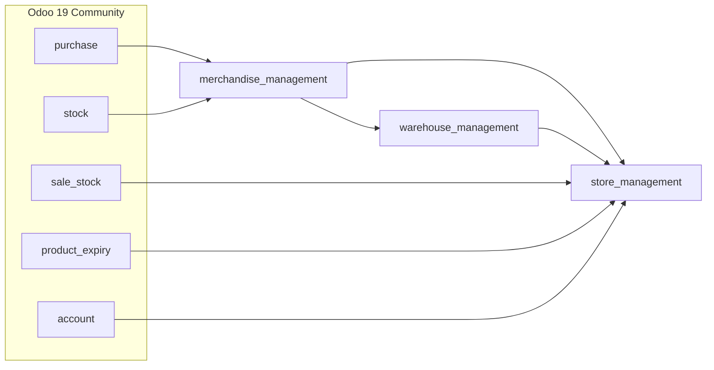
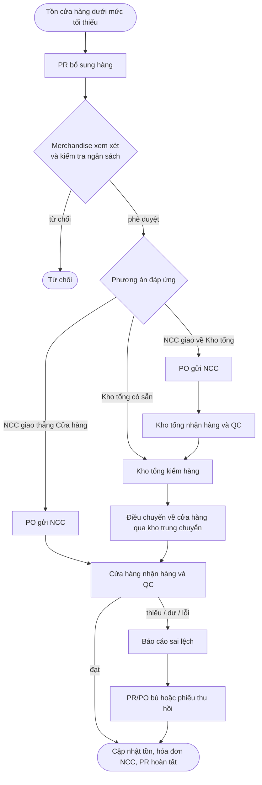

<div align="center">

# MIS Purchasing

### Quản lý mua hàng và bổ sung hàng cho chuỗi bán lẻ trên Odoo 19

[](https://www.odoo.com/)
[](https://www.python.org/)
[](https://www.postgresql.org/)
[](https://huggingface.co/spaces/IceMisha/OdooProject)
[](LICENSE)

[English](README.md) · **Tiếng Việt**

</div>

## Nhóm thực hiện

**Nhóm 1** — Viện Công nghệ Thông tin và Điện, Điện tử, Trường Đại học Giao thông Vận tải TP.HCM (UTH), 2026.

| Thành viên | Thành viên |
| --- | --- |
| Huỳnh Thái Bảo Ngân | Nguyễn Thị Mỹ Trinh |
| Phạm Như Trâm | Hoàng Quốc Khánh |
| Đỗ Hoàng Phúc | Trần Nguyên Thịnh |

**Giảng viên hướng dẫn:** ThS. Lê Hữu Thanh Tùng

> Đồ án môn *Đồ án thực tế Hệ thống thông tin quản lý*. Đề tài: *Phân tích quy trình nghiệp vụ quản lý mua hàng
> trong hệ thống ERP — Ứng dụng triển khai trên nền tảng Odoo tại Central Retail*. Phần phân tích dựa trên khảo sát
> quy trình thực tế; repository là sản phẩm học tập, không phải sản phẩm chính thức của Central Retail.

## Mục lục

- [Tổng quan](#tổng-quan)
- [AS-IS và TO-BE](#as-is-và-to-be)
- [Các module](#các-module)
- [Tính năng theo vai trò](#tính-năng-theo-vai-trò)
- [Luồng nghiệp vụ](#luồng-nghiệp-vụ)
- [Ảnh giao diện](#ảnh-giao-diện)
- [Phân tích GAP](#phân-tích-gap)
- [Chạy trên máy local](#chạy-trên-máy-local)
- [Triển khai lên Hugging Face Spaces](#triển-khai-lên-hugging-face-spaces)
- [Cấu trúc thư mục](#cấu-trúc-thư-mục)
- [Đánh giá và hướng phát triển](#đánh-giá-và-hướng-phát-triển)
- [Giấy phép](#giấy-phép)

## Tổng quan

Doanh nghiệp bán lẻ nhiều cửa hàng bổ sung hàng từ hai nguồn: kho tổng và nhà cung cấp (NCC). Khảo sát cho thấy
dữ liệu giữa cửa hàng, Merchandise, kho và NCC chưa đồng bộ theo thời gian thực, nhiều công đoạn còn thủ công qua
email, chưa có cảnh báo sớm cho thiếu hàng, dư hàng, hàng cận hạn hay sai lệch giao nhận.

Đề tài mô hình hóa quy trình cải tiến **TO-BE** bằng BPMN, **phân tích GAP** so với Odoo tiêu chuẩn và lấp các khoảng
trống bằng ba module tùy biến trên Odoo 19 Community. **Yêu cầu mua hàng (PR)** trở thành chứng từ trung tâm, liên kết
nhu cầu cửa hàng, quyết định của Merchandise, đơn mua hàng (PO), phiếu điều chuyển, kiểm tra chất lượng và bù hàng.

## AS-IS và TO-BE

| Nội dung | AS-IS | TO-BE (đã triển khai) |
| --- | --- | --- |
| Tạo yêu cầu mua hàng | Thủ công, thiếu đồng bộ, phụ thuộc nhân viên | Đề xuất PR theo định mức min/max, phân luồng theo nguồn cung |
| Phát hiện thiếu hàng | Kiểm tra định kỳ thủ công | Theo dõi tồn khả dụng và đang chờ bổ sung theo cửa hàng |
| Hàng cận hạn | Xử lý thủ công, dễ trễ | Tự phát hiện lô sắp hết hạn (số ngày cấu hình theo sản phẩm) |
| Khuyến mãi | Tạo tay, khó tra cứu | Scheduler tạo hằng ngày, tra cứu theo mã, sản phẩm, cửa hàng |
| Sai lệch nhận hàng | Trao đổi qua email | Báo cáo thiếu / dư / lỗi liên kết PR bù, PO bù hoặc phiếu thu hồi |
| Kiểm soát chi | Kiểm tra sau | Từ chối phê duyệt khi vượt ngân sách ngành hàng |

## Các module



| Module | Chức năng |
| --- | --- |
| [`merchandise_management`](custom_addons/merchandise_management) | PR duyệt nhiều cấp, ngân sách theo ngành hàng, vòng đời SKU và phân loại ABC, dừng đặt hàng, khuyến mãi (kể cả hàng cận hạn), báo cáo sai lệch, đánh giá NCC, dashboard |
| [`warehouse_management`](custom_addons/warehouse_management) | QC phiếu nhập (đạt / không đạt), ghi nhận hàng hư hỏng, tự tạo phiếu trả NCC hoặc hoàn trả nội bộ |
| [`store_management`](custom_addons/store_management) | Danh mục cửa hàng và định mức min/max, đề xuất bổ sung, luồng Kho tổng → Cửa hàng qua kho trung chuyển, kiểm hàng thực tế, bán hàng áp giá khuyến mãi, hóa đơn NCC đơn giản |

Cài **Store Management** sẽ tự cài kèm hai module còn lại.

## Tính năng theo vai trò

**Cửa hàng (Store)**

- Danh mục cửa hàng với người phụ trách, mức ưu tiên bổ sung; kho cửa hàng được tạo tự động.
- Định mức tồn tối thiểu / tối đa theo sản phẩm: tồn hiện có, khả dụng, đang chờ bổ sung và số lượng đề xuất.
- Tốc độ bán 30 ngày, số ngày tồn dự kiến, trạng thái tồn (cháy hàng, thiếu, bình thường, tồn cao, dư hàng).
- Tạo PR bổ sung một chạm; chặn PR trùng sản phẩm đang xử lý.
- Nhận hàng có bước kiểm đếm thực tế, ghi nhận thiếu / dư / hàng lỗi.
- Đơn bán chỉ chọn sản phẩm của cửa hàng, tự áp giá và hạn mức khuyến mãi.
- Doanh thu, lợi nhuận gộp và tỷ suất lợi nhuận theo cửa hàng.

**Merchandise**

- Quy trình PR: Nháp → Đã gửi → Chờ quản lý duyệt → Được phê duyệt → Đang thực hiện → Hoàn tất (hoặc Từ chối / Hủy).
- Phương án đáp ứng theo từng dòng PR: Kho tổng có sẵn, NCC giao về Kho tổng, NCC giao thẳng Cửa hàng.
- Ngân sách mua hàng theo ngành hàng: đã thực chi (PO), đã cam kết (PR) và còn lại.
- Vòng đời SKU (mới, đang kinh doanh, bán chậm, xả hàng, ngừng kinh doanh), phân loại ABC, cờ dừng đặt hàng.
- Từ báo cáo sai lệch tạo nhanh PR bù / PO bù hoặc phiếu thu hồi.
- Khuyến mãi theo cửa hàng có giới hạn số lượng; scheduler hằng ngày tạo khuyến mãi hàng cận hạn và cập nhật giá.
- Điểm uy tín, xếp hạng và lead-time trung bình của NCC; dashboard KPI, pipeline PR và hoạt động gần đây.

**Kho (Warehouse)**

- QC nhận hàng: bắt đầu kiểm → đạt (xác nhận nhập kho) hoặc không đạt (bắt buộc ghi chú).
- Số lượng hư hỏng và ghi chú lỗi theo dòng; theo dõi chênh lệch dự kiến – thực nhận.
- Phiếu bị từ chối tự sinh phiếu trả NCC hoặc hoàn trả nội bộ.
- Kho tổng kiểm hàng cho yêu cầu cửa hàng, giao qua kho trung chuyển và giữ nguyên số lô.
- Tự tạo hóa đơn NCC sau khi nhận hàng.

## Luồng nghiệp vụ



Sơ đồ BPMN đầy đủ (Bizagi): [`docs/bpmn-to-be-process.pdf`](docs/bpmn-to-be-process.pdf).

## Ảnh giao diện

| Định mức min/max và bổ sung hàng | Phương án đáp ứng trên PR |
| :---: | :---: |
|  |  |
| **Ngân sách mua hàng theo ngành hàng** | **Tồn kho theo số lô và hạn sử dụng** |
|  |  |
| **Khuyến mãi hàng cận hạn tự động** | **Bán hàng áp giá khuyến mãi** |
|  |  |

## Phân tích GAP

| Nhóm nghiệp vụ | Odoo tiêu chuẩn | Mức độ | Giải pháp trong repository |
| --- | --- | --- | --- |
| Nhu cầu cửa hàng và PR nội bộ | Chưa có luồng PR Store → Merchandise | Partial Fit | PR của `store_management` + `merchandise_management` |
| Phê duyệt PR | Cấu hình được nhưng chưa khớp quy trình | Partial Fit | Trạng thái nhiều cấp và kiểm tra theo vai trò |
| Tạo PO | Hỗ trợ đầy đủ | Full Fit | Purchase tiêu chuẩn, PO liên kết PR gốc |
| Tồn kho và điều chuyển | Hỗ trợ đầy đủ | Full / Config Fit | Cấu hình kho, tuyến trung chuyển, phiếu kho |
| Quyết định nguồn đáp ứng | Chưa có theo từng dòng PR | Gap / Partial | Tab Phương án xử lý trên PR |
| Nhận hàng và kiểm tra chất lượng | Chỉ nhận hàng, chưa có QC | Partial Fit | QC của `warehouse_management` |
| Xử lý sai lệch | Chỉ điều chỉnh tồn / trả hàng | Gap | Báo cáo sai lệch liên kết PR/PO bù, thu hồi |
| Khuyến mãi | Có nhưng chưa theo cửa hàng / lô | Partial Fit | Khuyến mãi theo cửa hàng và scheduler hàng cận hạn |
| Theo dõi trạng thái | Theo từng chứng từ | Partial Fit | Trạng thái luồng Kho tổng và dashboard Merchandise |

## Chạy trên máy local

Các module chạy trên Odoo 19 cài từ mã nguồn; không cần Docker khi phát triển.

**Yêu cầu**

- Python 3.10 trở lên
- PostgreSQL 13 trở lên
- Mã nguồn Odoo 19.0 — xem [hướng dẫn cài từ source chính thức](https://www.odoo.com/documentation/19.0/administration/on_premise/source.html)

**1. Tải Odoo và repository này**

```bash
git clone --depth 1 --branch 19.0 https://github.com/odoo/odoo.git odoo-19.0
git clone https://github.com/HoangPhucTony/Mis_Purchasing_OdooProject.git
```

**2. Cài thư viện Python cho Odoo** (nên dùng môi trường ảo)

```bash
cd odoo-19.0
python -m venv .venv
.venv\Scripts\activate
pip install -r requirements.txt
```

Trên Linux/macOS kích hoạt bằng `source .venv/bin/activate`.

**3. Tạo user PostgreSQL cho Odoo**

```sql
CREATE ROLE odoo WITH LOGIN CREATEDB PASSWORD 'odoo';
```

**4. Cấu hình Odoo** — sao chép [`odoo.conf.example`](odoo.conf.example) thành `odoo.conf`, sửa `addons_path`
gồm thư mục `addons` của Odoo và thư mục `custom_addons` của repository, cùng thông tin kết nối database.

**5. Chạy và cài module**

```bash
python odoo-bin -c ../Mis_Purchasing_OdooProject/odoo.conf -d mis_purchasing -i store_management
```

Mở <http://localhost:8069>, đăng nhập `admin` / `admin`. Sau đó vào **Thiết lập → Người dùng**, cấp quyền cho từng
người dùng ở mục *Bộ phận Merchandise*, *Cửa hàng* hoặc *Kho*.

Cập nhật module sau khi sửa code:

```bash
python odoo-bin -c ../Mis_Purchasing_OdooProject/odoo.conf -d mis_purchasing -u merchandise_management,warehouse_management,store_management
```

## Triển khai lên Hugging Face Spaces

Bản demo chạy dạng Docker Space, build từ [`Dockerfile`](Dockerfile) (image chính thức `odoo:19.0`, cổng 7860).

1. Mỗi lần push lên `main`, [GitHub Actions](.github/workflows/sync_to_hf.yml) được kích hoạt.
2. Workflow ghép metadata của Space từ [`.github/hf-space-metadata.md`](.github/hf-space-metadata.md) vào `README.md`
   rồi đẩy mã nguồn sang Space.
3. Space build lại image và chạy Odoo kết nối tới PostgreSQL bên ngoài.

Khai báo biến môi trường trong *Space → Settings → Variables and secrets* (mẫu: [`.env.example`](.env.example)):

| Biến | Ý nghĩa |
| --- | --- |
| `DB_HOST`, `DB_PORT`, `DB_USER`, `DB_PASSWORD` | Kết nối PostgreSQL bên ngoài |
| `ODOO_MASTER_PASSWORD` | Mật khẩu Database Manager — luôn đặt giá trị mạnh |
| `DB_FILTER` | Regex giới hạn database hiển thị |
| `MAX_CRON_THREADS` | Số luồng scheduler (mặc định `1`, `0` để tắt) |

Repository GitHub cần secret `HF_DEPLOY_ODOO` — Hugging Face access token có quyền ghi.

Muốn chạy thử đúng image của Space trên máy, [`docker-compose.yml`](docker-compose.yml) khởi động image cùng
PostgreSQL: `docker compose up -d --build`, rồi mở <http://localhost:7860>.

## Cấu trúc thư mục

```text
.
├── custom_addons/
│   ├── merchandise_management/   PR, ngân sách, khuyến mãi, sai lệch, dashboard
│   ├── store_management/         cửa hàng, min/max, Kho tổng → Cửa hàng, bán hàng
│   └── warehouse_management/     QC nhận hàng, trả hàng
├── docs/
│   ├── images/                   ảnh minh họa README
│   └── bpmn-to-be-process.pdf    sơ đồ BPMN quy trình TO-BE
├── .github/
│   ├── workflows/sync_to_hf.yml  triển khai lên Hugging Face Spaces
│   └── hf-space-metadata.md      cấu hình Space
├── Dockerfile                    image cho Hugging Face Spaces
├── docker-compose.yml            chạy thử image của Space trên máy
├── odoo.conf.example             cấu hình khi chạy từ mã nguồn
└── .env.example                  biến môi trường cho Space / Docker
```

## Đánh giá và hướng phát triển

Giải pháp đáp ứng các yêu cầu cốt lõi: PR là chứng từ trung tâm với quy trình trạng thái rõ ràng, Merchandise giữ vai
trò điều phối, xử lý rẽ nhánh theo hai nguồn đáp ứng (kho tổng hoặc NCC). Nhận hàng, QC, xử lý sai lệch, PR bù, thu hồi
và khuyến mãi đã được triển khai ở mức prototype.

Hướng phát triển:

- [ ] Kiểm thử với dữ liệu lớn, sát thực tế (nhiều cửa hàng, SKU, tình huống ngoại lệ đồng thời); thí điểm phạm vi nhỏ.
- [ ] Đồng bộ dữ liệu bán hàng POS để bổ sung hàng theo tốc độ tiêu thụ thực.
- [ ] Liên kết mua hàng, điều chuyển, khuyến mãi với kế toán (chi phí, công nợ, ngân sách).
- [ ] KPI nhà cung cấp: giao đúng hạn, tỷ lệ giao đủ, tỷ lệ hàng lỗi và sai lệch.
- [ ] Dashboard riêng cho cửa hàng, Merchandise, kho tổng và cấp quản lý.
- [ ] Phân quyền chi tiết và lưu vết thao tác giữa các bộ phận.

## Giấy phép

Phát hành theo giấy phép [GNU LGPL-3.0](LICENSE), tương thích với Odoo Community.
